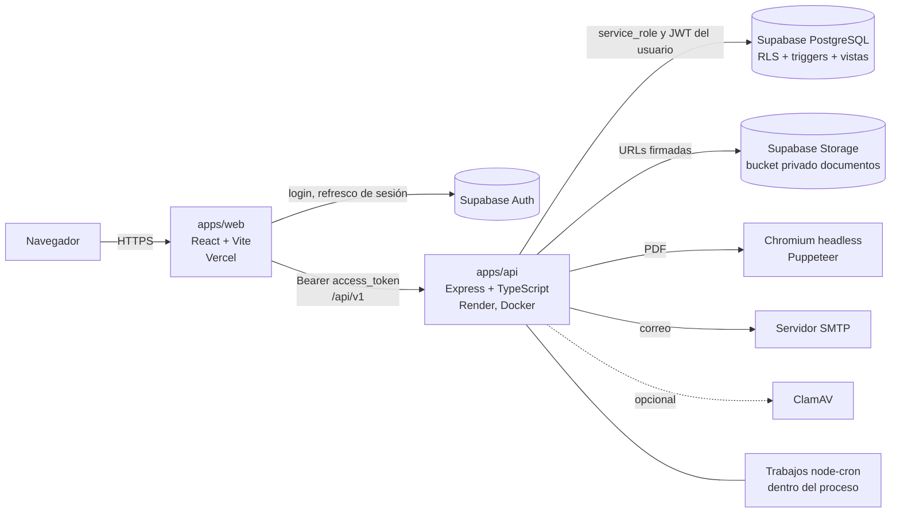
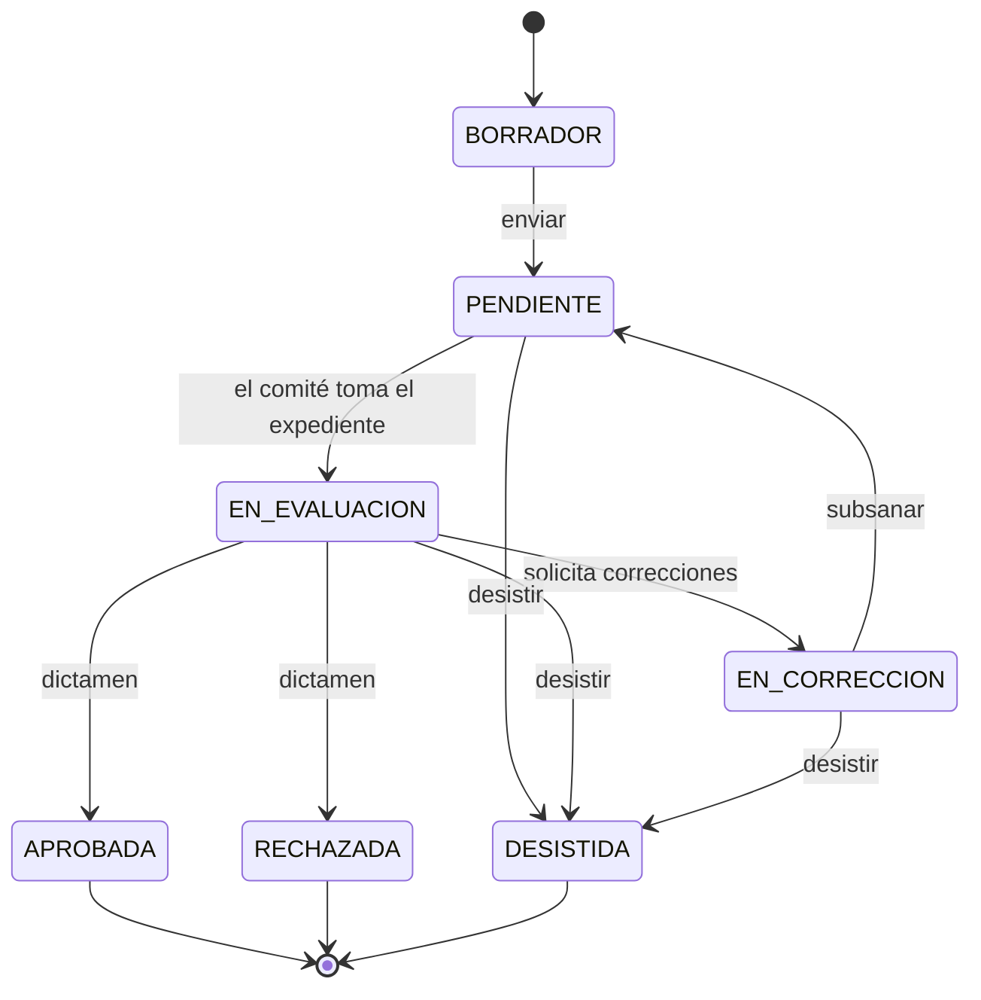

# FOEST: documentación técnica y código fuente

Plataforma web del **Fondo para la Educación Superior de Tocancipá (FOEST)**, Alcaldía Municipal de Tocancipá. Permite que los estudiantes se postulen a los beneficios del fondo, que el comité evaluador revise los expedientes y que la administración haga seguimiento de los desembolsos, la labor social y la auditoría.

Este documento cubre el punto **13.2** de la entrega (documentación técnica y código fuente). Está escrito para que una persona desarrolladora que no participó en el proyecto pueda **entender, instalar, configurar y ejecutar** la solución. El manual para personas usuarias está en [MANUAL_USUARIO.md](./MANUAL_USUARIO.md).

> **Fuente de verdad.** Si este documento contradice a [DECISIONES.md](./DECISIONES.md), gana `DECISIONES.md`. En particular, su sección 19 cambió la plataforma a Supabase: los textos de `docs/README.md` y de `docs/modules/*.md` que hablan de Prisma, S3/MinIO, Redis/BullMQ o JWT propio describen el diseño original y **no** lo que está implementado. Lo implementado es lo que se describe aquí.

## Contenido

1. [Alcance y código fuente](#1-alcance-y-código-fuente)
2. [Arquitectura y componentes tecnológicos](#2-arquitectura-y-componentes-tecnológicos)
3. [Lenguajes, marcos y dependencias](#3-lenguajes-marcos-y-dependencias)
4. [Estructura del repositorio](#4-estructura-del-repositorio)
5. [Base de datos](#5-base-de-datos)
6. [Integraciones y servicios externos](#6-integraciones-y-servicios-externos)
7. [Instalación y configuración](#7-instalación-y-configuración)
8. [Ejecución y pruebas](#8-ejecución-y-pruebas)
9. [API: convenciones y módulos](#9-api-convenciones-y-módulos)
10. [Reglas de negocio clave](#10-reglas-de-negocio-clave)
11. [Seguridad y protección de datos](#11-seguridad-y-protección-de-datos)
12. [Despliegue](#12-despliegue)
13. [Solución de problemas](#13-solución-de-problemas)
14. [Limitaciones técnicas y recomendaciones de mantenimiento](#14-limitaciones-técnicas-y-recomendaciones-de-mantenimiento)
15. [Documentos relacionados](#15-documentos-relacionados)

---

## 1. Alcance y código fuente

El código fuente completo está en este repositorio (monorepo de npm *workspaces*). No hay flujos de automatización externos (n8n, Zapier u otros): toda la lógica vive en la API y en la base de datos.

Funciones del MVP (18 módulos de negocio, cada uno con su documento en `docs/modules/`):

| Área | Módulos |
|---|---|
| Acceso y cuentas | `auth`, `accounts`, `roles_permissions` |
| Convocatorias | `convocatorias`, `catalogos_configuracion` |
| Postulación | `postulaciones`, `documentos`, `formatos_oficiales` |
| Evaluación | `asignaciones`, `evaluacion` |
| Seguimiento | `seguimiento_beneficios`, `labor_social` |
| Transversales | `auditoria`, `notificaciones`, `export_reports` |
| Paneles | `beneficiario_dashboard`, `dashboard_funcionario`, `admin_dashboard` |

Tres tipos de usuario (rol único por cuenta): **BENEFICIARIO**, **FUNCIONARIO** (comité evaluador) y **ADMINISTRADOR**.

## 2. Arquitectura y componentes tecnológicos



**Flujo de una petición autenticada**

1. La web inicia sesión con `@supabase/supabase-js` (correo + contraseña) y obtiene un `access_token`.
2. Cada llamada a la API lleva `Authorization: Bearer <token>`.
3. En la API: `helmet` y CORS → límite de peticiones → `authenticate()` (valida el token con `supabase.auth.getUser`, rechaza cuentas inactivas) → `requirePermission()` (matriz de permisos por rol) → `validate()` (esquemas Zod) → controlador → servicio.
4. El servicio usa `supabaseAsUser(token)` (las políticas RLS aplican) o `supabaseAdmin` (clave `service_role`, solo para operaciones de sistema: auditoría, trabajos programados, cambios de rol).
5. Los errores salen siempre como `{ code, message, details? }`.

**Dos barreras de seguridad:** la API (permisos + alcance) y la base de datos (RLS). El rol vive en `auth.users.app_metadata.rol` y solo se escribe desde la API.

| Capa | Tecnología | Dónde |
|---|---|---|
| Interfaz | React 18, TypeScript, Vite, Tailwind CSS 4, TanStack Query, React Router, Recharts | `apps/web` |
| API de negocio | Node.js ≥ 22, TypeScript, Express 4 (CommonJS) | `apps/api` |
| Contratos compartidos | Zod, enums, matriz de permisos | `packages/shared` |
| Autenticación | Supabase Auth (correo y contraseña) | Supabase |
| Base de datos | PostgreSQL de Supabase, SQL plano (sin ORM) | `supabase/migrations` |
| Archivos | Supabase Storage, bucket privado `documentos` | Supabase |
| PDF | Puppeteer + Handlebars, `pdf-lib`, `qrcode` | `apps/api` |
| Correo | `nodemailer` con *outbox* transaccional | `apps/api` |
| Trabajos programados | `node-cron` (dentro del proceso de la API) | `apps/api` |
| Registro | `pino` / `pino-http` | `apps/api` |

## 3. Lenguajes, marcos y dependencias

Lenguajes: **TypeScript** (API, web y paquete compartido), **SQL/PL/pgSQL** (migraciones) y **HTML/CSS** (plantillas de PDF y estilos).

Requisitos del entorno: **Node.js ≥ 22** y **npm ≥ 10** (campo `engines` de `package.json`).

Las versiones exactas están fijadas en `package-lock.json`. Dependencias principales (de los `package.json`):

**`apps/api`**

| Paquete | Uso |
|---|---|
| `express`, `cors`, `helmet`, `express-rate-limit` | Servidor HTTP, CORS, cabeceras de seguridad y límite de peticiones |
| `@supabase/supabase-js` | Acceso a Auth, base de datos y Storage |
| `zod` | Validación de entradas |
| `pino`, `pino-http` | Registro estructurado |
| `node-cron` | Trabajos programados |
| `nodemailer` | Envío de correo |
| `puppeteer`, `handlebars` | Generación de PDF (formatos y reportes) |
| `pdf-lib`, `qrcode` | Manipulación de PDF y código QR de verificación |
| `date-fns`, `date-fns-tz` | Fechas y zona `America/Bogota` |
| Desarrollo: `typescript`, `tsx`, `jest`, `ts-jest`, `supertest` | Compilación y pruebas |

**`apps/web`**

| Paquete | Uso |
|---|---|
| `react`, `react-dom`, `react-router-dom` | Interfaz y rutas |
| `@tanstack/react-query` | Datos del servidor y caché |
| `@supabase/supabase-js` | Sesión del usuario |
| `recharts` | Gráficas de los paneles |
| `zod`, `@foest/shared` | Validación y tipos compartidos |
| Desarrollo: `vite`, `tailwindcss`, `vitest`, `@testing-library/react`, `jsdom` | Compilación y pruebas |

**Regla del proyecto:** no se agregan, actualizan ni eliminan dependencias sin un *pull request* revisado por una persona. El árbol debe mantenerse en **0 vulnerabilidades** (`npm audit`); ver `README-DEV.md` §6.6 para los `overrides` que lo sostienen y no deben revertirse. La auditoría de dependencias se describe en `CLAUDE.md` y usa los scripts de `scripts/deps/`.

## 4. Estructura del repositorio

```
.
├─ apps/
│  ├─ api/                    API Express
│  │  ├─ src/
│  │  │  ├─ app.ts, server.ts       arranque, middlewares, registro de módulos
│  │  │  ├─ config/env.ts           variables de entorno validadas con Zod
│  │  │  ├─ shared/                 autenticación, RBAC, auditoría, errores, clientes Supabase
│  │  │  └─ modules/<modulo>/       routes, controller, service, dto, types, jobs, __tests__
│  │  └─ scripts/                   semilla de administrador, usuarios de prueba, festivos, SNIES
│  └─ web/                    Interfaz React
│     └─ src/
│        ├─ modules/<modulo>/       pages, components, hooks, api.ts, routes.tsx
│        ├─ components/ui           biblioteca de componentes (Button, Table, Modal…)
│        ├─ components/layout       encabezado, menú lateral, pie de página
│        ├─ lib/                    cliente API, sesión (AuthProvider), Supabase
│        └─ navigation.ts           menú lateral por rol
├─ packages/shared/           enums, matriz de permisos, esquemas Zod y tipos (@foest/shared)
├─ supabase/migrations/       0001 a 0022 (no existe la 0007)
├─ docs/                      especificación, guías y este documento
├─ scripts/deps/              verificador del informe de auditoría de dependencias
├─ tests/fixtures/deps/       casos de prueba del verificador
├─ Dockerfile, render.yaml    despliegue de la API (Render)
└─ apps/web/vercel.json       despliegue de la web (Vercel)  [no hay vercel.json en la raíz]
```

Convenciones obligatorias por módulo (detalle en `README-DEV.md` §6): el controlador solo traduce HTTP, las reglas de negocio van en el servicio, y todo enum, permiso o esquema usado por la API y la web va en `packages/shared`. Un recurso ajeno o no asignado responde **404** (nunca 403) para no revelar su existencia.

## 5. Base de datos

Motor: **PostgreSQL gestionado por Supabase**. El esquema se define con SQL plano en `supabase/migrations/NNNN_nombre.sql`, aplicado en orden numérico. Las migraciones son idempotentes: repetirlas no daña los datos. No se usa ORM.

### 5.1 Migraciones

| Archivo | Contenido |
|---|---|
| `0001_base` | Extensiones, enums, funciones de rol, tablas núcleo, vistas materializadas, semillas (roles, permisos, 12 beneficios, configuración, festivos 2026, declaraciones) |
| `0002_auth` | Intentos de inicio de sesión (anti fuerza bruta) sobre Supabase Auth |
| `0003_accounts` | Cuentas de funcionarios, perfiles de beneficiarios y habeas data |
| `0004_roles_permissions` | Permiso `rol:consultar` (la matriz base está en `0001`) |
| `0005_convocatorias`, `0006_postulaciones` | Ciclo de vida de convocatorias; postulaciones, envíos y subsanación |
| `0008_dashboard_funcionario`, `0009_admin_dashboard` | Métricas y alertas |
| `0010_catalogos_configuracion` | Configuración, festivos, SNIES, declaraciones |
| `0011_auditoria` | Bitácora con cadena de hashes |
| `0012_notificaciones` | Notificaciones y *outbox* de correo |
| `0013_integracion_p0` | Parámetros de configuración que integran notificaciones y catálogos con postulaciones |
| `0014_documentos` | Documentos, versiones y bucket privado |
| `0015_formatos_oficiales` | Formatos GE-F041 y GE-F043 |
| `0016_asignaciones`, `0017_evaluacion` | Asignación de expedientes y dictámenes |
| `0018_seguimiento_beneficios`, `0019_labor_social`, `0020_export_reports`, `0022_reportes_html` | Otorgamientos y desembolsos, labor social, reportes |
| `0021_correcciones_verificacion` | Correcciones de la verificación integral |

### 5.2 Tablas (todas con RLS activo)

| Grupo | Tablas |
|---|---|
| Identidad y roles | `usuario`, `rol`, `permiso`, `rol_permiso`, `intento_login`, `funcionario`, `beneficiario`, `acudiente` |
| Habeas data | `consentimiento_datos`, `texto_consentimiento`, `solicitud_habeas_data`, `destinatario_suprimido` |
| Convocatorias | `convocatoria`, `convocatoria_beneficio`, `beneficio`, `ampliacion_convocatoria`, `convocatoria_cambio_estado` |
| Postulaciones | `postulacion`, `postulacion_envio`, `postulacion_beneficio`, `historial_estado_postulacion`, `datos_pago_st` |
| Documentos y formatos | `tipo_documento`, `requisito_documento`, `documento`, `documento_version`, `formato_generado`, `declaracion_juramentada` |
| Asignación y evaluación | `asignacion_funcionario`, `postulacion_asignacion`, `conflicto_interes`, `revision`, `revision_beneficio`, `revision_documento` |
| Seguimiento | `otorgamiento`, `otorgamiento_evento`, `desembolso`, `cuenta_pago`, `carga_pagos` |
| Labor social | `certificado_labor_social`, `actividad_labor_social`, `labor_social_emision` |
| Configuración y catálogos | `configuracion_sistema`, `festivo`, `ies_snies`, `programa_snies`, `importacion_snies` |
| Notificaciones | `notificacion`, `preferencia_notificacion`, `evento_outbox`, `entrega_correo` |
| Auditoría y reportes | `auditoria_evento`, `auditoria_evento_pendiente`, `auditoria_integridad`, `reporte_generado`, `metricas_refresh` |

Vistas materializadas: `mv_postulacion_envio` y `mv_postulacion_beneficio` (grano correcto para métricas; se refrescan cada 5 minutos). Existen unas 88 funciones SQL, entre ellas `auth_rol()`, `es_administrador()`, `fn_enviar_postulacion()`, `fn_es_dia_habil()`, `fn_sumar_dias_habiles()` y `fn_cupos_ocupacion()`.

Reglas garantizadas por la propia base de datos (no solo por la API):

- Las tablas `postulacion_envio`, `consentimiento_datos` y `auditoria_evento` son **inmutables** (triggers de bloqueo).
- Una postulación no puede salir de un **estado terminal** (APROBADA, RECHAZADA, DESISTIDA).
- La bitácora de auditoría calcula una **cadena de hashes** con un trigger.
- El perfil `public.usuario` se crea con el trigger `on_auth_user_created` sobre `auth.users`.

### 5.3 Estados de una postulación



### 5.4 Almacenamiento de archivos

Bucket privado `documentos` de Supabase Storage: solo PDF, JPG y PNG, máximo 10 MB (configurable con `MAX_TAMANO_ARCHIVO_MB`). Nunca se exponen rutas públicas: la API entrega URLs firmadas de corta duración (5 minutos para lectura).

## 6. Integraciones y servicios externos

| Servicio | Obligatorio | Para qué | Configuración |
|---|---|---|---|
| **Supabase** (Auth, PostgreSQL, Storage) | Sí | Persistencia, autenticación y archivos | `SUPABASE_URL`, `SUPABASE_ANON_KEY`, `SUPABASE_SERVICE_ROLE_KEY` |
| **Chromium** (vía Puppeteer) | Sí, para PDF | Generar los formatos GE-F041, GE-F043, GE-F038 y reportes | En local lo descarga Puppeteer; en Docker se instala del sistema (`PUPPETEER_EXECUTABLE_PATH`) |
| **SMTP** | No (recomendado en producción) | Correos de notificación | `SMTP_HOST`, `SMTP_PORT`, `SMTP_USER`, `SMTP_PASS`, `SMTP_SECURE`, `MAIL_FROM` |
| **ClamAV** | No | Antivirus de archivos cargados | `CLAMAV_HOST`, `CLAMAV_PORT` |
| **Vercel** | Solo en producción | Alojar la web | Variables `VITE_*` |
| **Render** | Solo en producción | Alojar la API (Docker) | `render.yaml` |

Si no hay SMTP, los correos se escriben en el registro de la API (`ConsoleMailer`) y no llegan a nadie. Si no hay ClamAV, los archivos se aceptan marcados como «escaneo omitido». Los correos de verificación de cuenta, recuperación de contraseña e invitaciones los envía **Supabase Auth**, no la API (tienen límite por hora; para volumen real configure un SMTP propio en Supabase → Authentication → SMTP Settings).

## 7. Instalación y configuración

### 7.1 Requisitos previos

- Node.js ≥ 22 y npm ≥ 10.
- Un proyecto de Supabase (el del FOEST es `kixjejmewgynzrppowfv`) y sus tres credenciales: *Project URL*, *anon key* y *service_role key* (Supabase → Project Settings → API).
- Acceso al SQL Editor de Supabase o a la CLI de Supabase.

### 7.2 Pasos

1. **Obtener el código e instalar**

   ```bash
   git clone <url-del-repositorio> foest
   cd foest
   npm install
   ```

   Instala las tres carpetas de trabajo y enlaza `@foest/shared`.

2. **Crear los archivos de entorno** (nunca se suben al repositorio):

   ```bash
   cp apps/api/.env.example apps/api/.env
   cp apps/web/.env.example apps/web/.env
   ```

   Complete los valores según las tablas de la sección 7.3. La clave `service_role` **nunca** va en `apps/web`.

3. **Aplicar las migraciones** en Supabase, en orden numérico (`0001` a `0022`, sin `0007`). Opción A: SQL Editor → pegar cada archivo → *Run*. Opción B (CLI):

   ```bash
   npx supabase login
   npx supabase link --project-ref kixjejmewgynzrppowfv
   npx supabase db push
   ```

4. **Configurar las redirecciones de correo** en Supabase → Authentication → URL Configuration: agregar `http://localhost:5173/verificar-correo`, `http://localhost:5173/restablecer` y `http://localhost:5173/invitacion`.

5. **Crear el primer administrador** (no existe un registro público para este rol). Defina `ADMIN_EMAIL` y `ADMIN_PASSWORD` en `apps/api/.env` y ejecute:

   ```bash
   npm run seed:admin
   ```

6. **Comprobar la conexión** (informa conexión, tablas clave y estado de RLS):

   ```bash
   npm run verify:supabase
   ```

7. **(Opcional) Datos de demostración.** Para obtener un usuario por rol con una contraseña elegida por usted:

   ```bash
   cd apps/api
   QA_PASSWORD='UnaClave#2026' npx tsx --env-file-if-exists=.env scripts/crear-usuarios-prueba.ts
   ```

   Crea `prueba.admin@foest.test`, `prueba.funcionario1@foest.test`, `prueba.funcionario2@foest.test` y `prueba.beneficiario@foest.test`. **No lo ejecute en producción.** Otros scripts útiles: `npm run festivos:seed -w apps/api` (festivos de Colombia) y `npm run snies:import -w apps/api` (catálogo SNIES).

### 7.3 Variables de entorno

**API (`apps/api/.env`)**

| Variable | Obligatoria | Valor por defecto | Descripción |
|---|---|---|---|
| `SUPABASE_URL` | Sí | n/d | *Project URL* |
| `SUPABASE_ANON_KEY` | Sí | n/d | Clave pública |
| `SUPABASE_SERVICE_ROLE_KEY` | Sí | n/d | Clave de servicio (secreta) |
| `PORT` | No | `4000` | Puerto de la API (Render lo inyecta) |
| `WEB_ORIGIN` | No | `http://localhost:5173` | Origen permitido por CORS y base de los enlaces de correo; en producción, la URL exacta de la web sin barra final |
| `LOG_LEVEL` | No | `info` | `trace`…`silent` |
| `RATE_LIMIT_WINDOW_MS` | No | `900000` | Ventana del límite de peticiones (15 min) |
| `RATE_LIMIT_MAX` | No | `300` | Peticiones por IP por ventana |
| `DATOS_PAGO_KEY` | Para subsidio de transporte | n/d | 64 caracteres hexadecimales que cifran los datos de pago. Si se pierde, esos datos no se pueden leer. Generar con `node -e "console.log(require('crypto').randomBytes(32).toString('hex'))"` |
| `DATOS_PAGO_KEY_VERSION` | No | `v1` | Versión de la clave de cifrado |
| `SMTP_HOST`, `SMTP_PORT`, `SMTP_USER`, `SMTP_PASS`, `SMTP_SECURE`, `MAIL_FROM` | No | vacío | Correo saliente; vacío = solo al registro |
| `MAIL_WEBHOOK_SECRET` | No | n/d | Secreto del webhook de correo (≥ 16 caracteres) |
| `CLAMAV_HOST`, `CLAMAV_PORT` | No | n/d | Antivirus |
| `PUPPETEER_EXECUTABLE_PATH` | No | n/d | Ruta de Chromium del sistema |
| `ADMIN_EMAIL`, `ADMIN_PASSWORD` | Solo para `seed:admin` | n/d | Primer administrador |

**Web (`apps/web/.env`)**

| Variable | Descripción |
|---|---|
| `VITE_SUPABASE_URL` | *Project URL* |
| `VITE_SUPABASE_ANON_KEY` | Clave pública (**nunca** la `service_role`) |
| `VITE_API_URL` | URL base de la API sin barra final, por ejemplo `http://localhost:4000/api/v1` |

Las variables `VITE_*` se incrustan al compilar: si cambian, hay que recompilar.

Sin credenciales de Supabase la API **arranca igual**: `GET /api/v1/health` responde `{"ok":true,"supabase":"sin_credenciales"}` y las rutas autenticadas responden `503 SIN_CREDENCIALES_SUPABASE`.

## 8. Ejecución y pruebas

### 8.1 Ejecutar en desarrollo

```bash
npm run dev                 # API en http://localhost:4000/api/v1 y web en http://localhost:5173
npm run dev -w apps/api     # solo la API (recarga automática con tsx watch)
npm run dev -w apps/web     # solo la web (Vite)
```

Compruebe la API en `http://localhost:4000/api/v1/health` (debe responder `"supabase":"ok"`) y abra `http://localhost:5173`. El puerto 5173 es estricto: si está ocupado, detenga la instancia anterior.

### 8.2 Compilar y ejecutar en modo producción

```bash
npm run build               # shared → api (dist/) → web (dist/)
npm run start -w apps/api   # sirve la API compilada
```

La web compilada (`apps/web/dist`) es un sitio estático; se sirve con cualquier hosting estático con reescritura de rutas a `index.html`.

### 8.3 Pruebas

```bash
npm run typecheck           # tipos de shared, api y web
npm test                    # shared (Jest) + api (Jest + Supertest) + web (Vitest + Testing Library)
npm run lint                # comprobación de tipos en todos los paquetes
```

Resultado de la última ejecución (17 de noviembre de 2026): `npm test` termina con código 0: shared 3 pruebas, API 1064 pruebas en 18 suites y web 45 pruebas en 17 archivos.

Las pruebas **no necesitan credenciales**: los servicios reciben un cliente de Supabase simulado (`__setSupabaseAdminForTests`). Hay una prueba de la matriz de acceso rol × endpoint (`apps/api/src/__tests__/rbac.test.ts`) que falla si la matriz de TypeScript y el seed SQL difieren.

Verificación de la auditoría de dependencias:

```bash
node --test scripts/deps/verificar-informe.test.mjs
node scripts/deps/verificar-informe.mjs --casos tests/fixtures/deps
```

**Recorrido manual de punta a punta:** siga [GUIA_PRUEBAS.md](./GUIA_PRUEBAS.md) (un recorrido por rol con la base real). El resultado de la última verificación integral está en [VERIFICACION_REAL.md](./VERIFICACION_REAL.md).

## 9. API: convenciones y módulos

Prefijo `/api/v1`. Autenticación con `Authorization: Bearer <access_token>` (excepto las rutas públicas, una lista cerrada en `DECISIONES.md` §7).

| Código | Significado |
|---|---|
| 401 | Sin sesión o token inválido |
| 403 | El rol no tiene el permiso, o `CUENTA_INACTIVA` |
| 404 | Recurso inexistente, ajeno o no asignado |
| 409 | Conflicto de estado o de versión (`VERSION_CONFLICTO`) |
| 422 | Datos inválidos o incompletos (con `details` de Zod) |
| 429 | Demasiadas peticiones (`DEMASIADAS_PETICIONES`) |
| 503 | Sin credenciales de Supabase, o migración pendiente (`MIGRACION_PENDIENTE`) |

Paginación: `?page=1&page_size=20`, respuesta `{ data, total, ... }`. Las operaciones que modifican datos usan control de versión optimista.

| Prefijo | Módulo | Quién lo usa |
|---|---|---|
| `/auth` | Inicio de sesión, registro, recuperación, invitación, cambio de clave | Todos |
| `/publico/convocatorias`, `/publico/verificar` | Convocatorias abiertas y verificación de formatos | Público |
| `/convocatorias`, `/beneficios` | Ciclo de vida de convocatorias, comité, ampliaciones | Administrador (escritura); todos (lectura) |
| `/beneficiarios`, `/funcionarios`, `/administradores`, `/habeas-data` | Cuentas, perfiles y derechos del titular | Según rol |
| `/postulaciones` | Borrador, envío, subsanación, desistimiento; además `/postulaciones/:id/documentos` y `/formatos` | Beneficiario; lectura de otros roles |
| `/documentos`, `/tipos-documento` | Soportes, versiones y URLs firmadas | Beneficiario, comité |
| `/formatos` | Formatos GE-F041 y GE-F043 | Beneficiario |
| `/asignaciones` | Bandeja, tomar, liberar, conflicto de interés, reasignar | Funcionario, administrador |
| `/evaluacion` | Chequeo de documentos y dictamen por beneficio | Funcionario |
| `/seguimiento` | Otorgamientos, desembolsos, cupos, carga masiva de pagos | Administrador; beneficiario (lo suyo) |
| `/labor-social` | Certificados y actividades (GE-F038) | Beneficiario; funcionario (lectura) |
| `/notificaciones` | Avisos dentro de la plataforma y entregas de correo | Todos |
| `/reportes` | Consolidados HTML/CSV, resumen PDF | Funcionario, administrador |
| `/dashboard/{beneficiario,funcionario,admin}` | Paneles | Por rol |
| `/auditoria` | Bitácora, exportación, integridad | Administrador |
| `/configuracion`, `/festivos`, `/catalogos`, `/admin/catalogos`, `/roles`, `/permisos` | Parámetros del sistema y seguridad | Administrador |

La lista completa de permisos y su asignación por rol está en `packages/shared/src/permisos.ts`. En la interfaz se puede consultar en **Administración → Seguridad → Matriz de permisos**.

### Trabajos programados (dentro de la API, zona `America/Bogota`)

| Frecuencia | Trabajo |
|---|---|
| Cada minuto | Cierre automático de convocatorias vencidas; cola de auditoría; cola de reportes; correo pendiente (*outbox*) |
| Cada 2 minutos | Reintento de escaneo antivirus |
| Cada 5 minutos | Recuperación del *outbox*; refresco de vistas materializadas de métricas |
| Cada hora (min 7) | Purga de cargas incompletas |
| Diario 02:30–08:30 | Verificación de integridad de auditoría (02:30), retención de documentos (03:00), cupos (07:00), recordatorios y alertas (08:00 y 08:30), vencimiento de subsanación |
| Mensual (día 1) | Limpieza de notificaciones; revisión de retención de auditoría |

Como corren **dentro del proceso**, debe haber **una sola instancia** de la API; con varias, los trabajos se duplicarían.

## 10. Reglas de negocio clave

Todos estos valores son **parámetros editables** (Administración → Configuración) y no están cableados en el código:

- Días hábiles de subsanación, tope diario de horas de labor social, horas mínimas, tamaño máximo de archivo, umbrales de alertas, edad de mayoría, textos de consentimiento y de declaraciones.
- Los plazos se calculan en días hábiles con la tabla `festivo` y la zona `America/Bogota`.
- Hacia el beneficiario, la persona evaluadora es anónima: las observaciones se firman como «Equipo FOEST».
- Los datos personales de un expediente solo se muestran a quien lo tiene asignado; en la bandeja (*pool*) el funcionario ve solo datos mínimos.
- Las cifras agregadas de los paneles aplican **k-anonimato**: los grupos con menos de 5 casos se muestran como «Otros / Casos aislados».
- La firma de los formatos GE-F041, GE-F043 y GE-F038 es **manuscrita**; el código QR solo permite verificar que la plataforma emitió el archivo.

## 11. Seguridad y protección de datos

- **Habeas data (Ley 1581 de 2012).** Consentimiento versionado y no modificable; solicitudes de acceso, rectificación y supresión (la supresión aprobada anonimiza al titular de forma irreversible).
- **Auditoría.** Cada acción relevante y cada lectura de datos sensibles queda en una bitácora con cadena de hashes y verificación diaria de integridad. La auditoría redacta contraseñas, tokens, URLs firmadas y números de cuenta.
- **Cifrado.** Los datos de pago se cifran con `DATOS_PAGO_KEY`; las cuentas se muestran siempre enmascaradas (`•••• 1234`).
- **Archivos.** Bucket privado, validación de tipo real (un `.exe` renombrado a `.pdf` se rechaza), rechazo de PDF cifrados o con JavaScript, URLs firmadas de corta duración.
- **Acceso.** Bloqueo por intentos fallidos (5 fallos por correo y 20 intentos por IP cada 15 minutos) y límite general de 300 peticiones por IP cada 15 minutos.
- **Informes y registros.** Nunca copie datos de beneficiarios a informes, *issues* ni registros. No lea ni imprima archivos `.env`.

## 12. Despliegue

Producción: **web en Vercel**, **API en Render** (imagen Docker, plan *Starter*; no usar *Free* porque se duerme y detiene los trabajos), **datos en Supabase**. La guía paso a paso, con la tabla de variables y los problemas frecuentes, está en [DESPLIEGUE.md](./DESPLIEGUE.md). **Atención:** `DESPLIEGUE.md` dice que el `vercel.json` está en la raíz y que el *Root Directory* de Vercel va vacío; en el repositorio actual el archivo es `apps/web/vercel.json` y sus órdenes (`cd ../.. && npm ci`) suponen que el *Root Directory* de Vercel es `apps/web`. Si el despliegue falla, revise primero ese ajuste. Resumen del orden: 1) Supabase con las migraciones aplicadas, 2) API en Render con `render.yaml`, 3) web en Vercel, 4) volver a Render para fijar `WEB_ORIGIN` con la URL real y a Supabase para las URL de redirección.

## 13. Solución de problemas

| Síntoma | Causa y solución |
|---|---|
| `/api/v1/health` dice `"supabase":"sin_credenciales"` | Faltan una o más de las tres variables `SUPABASE_*` en `apps/api/.env` |
| La web carga pero todo da error de red | `VITE_API_URL` mal escrita, o no se recompiló tras cambiarla |
| La consola del navegador dice «CORS» | `WEB_ORIGIN` no coincide **exactamente** con la URL de la web (sin barra final, con `https` en producción) |
| Error `503 MIGRACION_PENDIENTE` | Falta aplicar una migración de `supabase/migrations/` |
| Error `429 DEMASIADAS_PETICIONES` | Se agotó el límite por IP. Espere 15 minutos; en desarrollo, reinicie la API (el contador está en memoria) o suba `RATE_LIMIT_MAX` |
| «Se realizaron demasiados intentos» al iniciar sesión | Bloqueo por intentos fallidos o por IP (15 minutos) |
| Falla la generación de PDF | Chromium no disponible o poca memoria. Revise `PUPPETEER_EXECUTABLE_PATH` o suba el plan del servidor |
| No llegan correos | `SMTP_*` vacío (solo van al registro) o el proveedor rechaza el remitente `MAIL_FROM`; los correos de Supabase Auth tienen límite por hora y los dominios `.test` no reciben correo |
| No se pueden guardar datos de pago | Falta `DATOS_PAGO_KEY` |
| Los archivos quedan «escaneo omitido» | No hay ClamAV configurado (comportamiento esperado) |
| Recargar `/login` da 404 | Falta la regla de reescritura de rutas a `index.html` (en Vercel, `vercel.json`) |
| `apps/api/.env` con valores que no cargan | Verifique que los valores no empiecen con espacio |

Para reportar un fallo incluya: la ruta o pantalla, el mensaje en pantalla, la petición y respuesta de la pestaña *Network* (sin *tokens*) y las últimas líneas del registro de la API.

## 14. Limitaciones técnicas y recomendaciones de mantenimiento

**Limitaciones conocidas**

1. **Una sola instancia de la API.** Los trabajos programados corren dentro del proceso con `node-cron`. Para escalar horizontalmente hay que mover los trabajos a una cola externa (BullMQ/Redis, previsto en el diseño original) o usar un bloqueo distribuido.
2. **Límite de peticiones en memoria.** El contador de `express-rate-limit` se pierde al reiniciar y no se comparte entre instancias.
3. **Antivirus opcional.** Sin ClamAV, los archivos se aceptan sin escanear.
4. **Correo.** Sin SMTP los correos no salen; los de Supabase Auth tienen límite horario.
5. **Texto jurídico provisional.** El pagaré, las declaraciones juramentadas y los textos de los formatos GE-F038, GE-F041 y GE-F043 son genéricos y requieren validación jurídica ([PENDIENTES.md](./PENDIENTES.md)). Mientras no estén confirmados, el sistema los marca como `PROVISIONAL`.
6. **Rendimiento de lectura.** El detalle de una postulación hace consultas secuenciales a la base remota y puede tardar entre 2 y 5 segundos (defecto D-05 de `VERIFICACION_REAL.md`).
7. **Imagen Docker.** Su construcción no se probó localmente; el primer despliegue en Render es la prueba real.
8. **Aviso de «módulo en construcción».** La ruta `/funcionario/postulaciones/:id/evaluacion` muestra un marcador; la evaluación se abre desde la bandeja en `/funcionario/evaluacion/:id`.
9. **Documentación de diseño desactualizada en parte.** `CLAUDE.md` y `docs/README.md` mencionan Node 20, Prisma, S3/MinIO y Redis. La implementación real usa Node 22 y Supabase (ver el aviso al inicio).
10. **Firma manuscrita.** La plataforma no firma digitalmente; los formatos se imprimen, firman y suben escaneados.

**Recomendaciones de mantenimiento**

- Ejecute `npm audit` y `npm test` antes de cada versión; no revierta los `overrides` de `package.json` (`README-DEV.md` §6.6).
- Toda tabla nueva debe llevar RLS y políticas; numere las migraciones en secuencia (`0023_…`) y manténgalas idempotentes. Si cambia la matriz de permisos, edite `packages/shared/src/permisos.ts` **y** el bloque `-- BEGIN SEED rol_permiso` de la migración.
- Guarde `DATOS_PAGO_KEY` en un gestor de contraseñas y rótela con `DATOS_PAGO_KEY_VERSION`.
- Cada año: cargue los festivos del nuevo año (`npm run festivos:seed -w apps/api` o Administración → Festivos), pues los plazos en días hábiles dependen de ellos.
- Actualice el catálogo SNIES cuando el Ministerio publique cambios.
- Revise cada semana el panel del administrador (alertas) y la verificación de integridad de la auditoría.
- Limpie los usuarios `prueba.*`, `qa+*` y `verif.*` y los datos de prueba antes de abrir el sistema a usuarios reales (Supabase → Authentication → Users).
- Aplique la política de retención de datos cuando el FOEST la defina ([PENDIENTES.md](./PENDIENTES.md)).

## 15. Documentos relacionados

| Documento | Contenido |
|---|---|
| [MANUAL_USUARIO.md](./MANUAL_USUARIO.md) | Manual de usuario con capturas de pantalla (punto 13.3) |
| [DECISIONES.md](./DECISIONES.md) | Decisiones canónicas (estados, permisos, reglas transversales) |
| [README.md](./README.md) | Especificación y plan de desarrollo modular |
| [`modules/`](./modules) | Una especificación por módulo |
| [`../README-DEV.md`](../README-DEV.md) | Guía de desarrollo y convenciones |
| [`../supabase/README.md`](../supabase/README.md) | Detalle de la base de datos y migraciones |
| [GUIA_PRUEBAS.md](./GUIA_PRUEBAS.md) | Recorrido manual de pruebas por rol |
| [VERIFICACION_REAL.md](./VERIFICACION_REAL.md) | Resultado de la verificación contra la base real |
| [DESPLIEGUE.md](./DESPLIEGUE.md) | Despliegue en Vercel, Render y Supabase |
| [PENDIENTES.md](./PENDIENTES.md) | Puntos abiertos que requieren validación jurídica o del FOEST |
